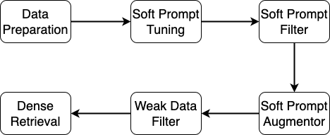

<div align="center">

# [SPTAR](https://arxiv.org/abs/2307.08303)

</div>

# ¿Qué es?
SPTAR representa `Soft Prompt Tuning for Augmenting Dense Retrieval with Large Language Models`, el cual consta de seis módulos como se muestra en la siguiente imagen:

<div align="center">

</div>

Este repositorio consta de dos directorios `xuyang` y `zhiyuan`, donde `xuyang` contiene los módulos de ajuste de `soft prompt`, filtro de `soft prompt` y aumentador de `soft prompt`. `zhiyuan` contiene los módulos de filtro de datos débiles y recuperación densa. Consulte el archivo readme de `xuyang` para generar pares de documento-pregunta débiles sin limpiar. Siga este archivo readme para reproducir los resultados.

# Reproducción de Resultados

## Configuración del entorno py37
El entorno `py37` se utiliza para DPR, BM25CE y la generación de datos para ColBERT:
```
python zhiyuan/retriever/dpr/train/gen_data_for_colbert.py
```
Cree el entorno `py37` con:
```
conda env create -f environment.yml
```
Si encuentra este error:
```
nvidia/cublas/lib/libcublas.so.11: symbol cublasLtGetStatusString version libcublasLt.so.11 not defined in file libcublasLt.so.11 with link time reference
```
Luego, ejecute el siguiente comando en su entorno `py37`:
```
pip uninstall nvidia_cublas_cu11
```
Si encuentra este error:
```
Traceback (most recent call last):
  File "<stdin>", line 1, in <module>
  File "/opt/conda/envs/tasb/lib/python3.8/site-packages/torch/utils/cpp_extension.py", line 25, in <module>
    from pkg_resources import packaging  # type: ignore[attr-defined]
ImportError: cannot import name 'packaging' from 'pkg_resources' (/opt/conda/envs/tasb/lib/python3.8/site-packages/pkg_resources/__init__.py)
```
Luego, reduzca sus `setuptools` a `setuptools=69.5.1` en su entorno.
Hemos modificado los paquetes beirV1.0.1 y sentence-transformersV2.2.2, por lo que, después de configurar el entorno `py37`, instale estos dos paquetes localmente:
```
cd package/beir
pip install -e .
cd package/sentence-transformers
pip install -e .
```

## Configuración del entorno col37bert
El entorno col37bert es para ColBERT. Cree el entorno col37bert con:
```
conda env create -f zhiyuan/retriever/col_bert/col37bert.yml
```
## Preparación de datos
Para asegurarse de tener exactamente los mismos datos que los nuestros, le recomendamos descargar nuestros `datasets` desde [Google Drive](https://drive.google.com/drive/folders/1wjwevAAORCf_vunP0OsoArfdwpP25QuO?usp=sharing) y colocar la carpeta `datasets` en la ruta `zhiyuan/`. O puede descargar el conjunto de datos BEIR y generar los archivos necesarios con los `comandos` a continuación:

```
python zhiyuan/download.py
python zhiyuan/data_process.py 
```

`zhiyuan/data_process.py` se utiliza para generar tres archivos jsonl para cada conjunto de datos:
1. zhiyuan/datasets/raw/beir/fiqa o msmarco/corpus_filtered.jsonl
2. zhiyuan/datasets/raw/beir/fiqa o msmarco/corpus_5000_reduced_ratio_20.jsonl
3. zhiyuan/datasets/raw/beir/fiqa o msmarco/corpus_100k_reduced_ratio_20.jsonl

El archivo `corpus_filtered.jsonl` almacena todos los documentos sin etiquetar. `corpus_5000_reduced_ratio_20.jsonl` almacena el corpus pequeño muestreado para una evaluación rápida durante el entrenamiento de DPR cuando el número de pares débiles es 5000. De manera similar, `corpus_100k_reduced_ratio_20.jsonl` se utiliza para una evaluación rápida durante el entrenamiento de DPR cuando el número de pares débiles es 100k. Para ColBERT, ejecutamos el código oficial de ColBERT y no hay evaluación después de cada época. Ejecutamos `ColBERT` durante 20 épocas y evaluamos los puntos de control (3, 5, 10, 15, 18, 20) en el conjunto de datos de prueba, reportando los mejores resultados. Por lo tanto, para ColBERT, no es necesario utilizar estos corpus muestreados.

## Comandos

### BM25
```
# fiqa
docker pull beir/pyserini-fastapi
docker run -p 8002:8000 -it --name fiqa --rm beir/pyserini-fastapi:latest
python zhiyuan/retriever/bm25anserini/evaluate_anserini_bm25.py --dataset_name fiqa

# msmarco
docker pull beir/pyserini-fastapi 
docker run -p 8000:8000 -it --name msmarco --rm beir/pyserini-fastapi:latest
python zhiyuan/retriever/bm25anserini/evaluate_anserini_bm25.py --dataset_name msmarco
```

### W/O

#### DPR
```
# fiqa
python zhiyuan/dpr_eval.py --dataset_name fiqa --version v1 --gpu_id 0 --train_num 50 -exps no_aug --weak_num 100k

# msmarco
python zhiyuan/dpr_eval.py --dataset_name msmarco --version v1 --gpu_id 0 --train_num 50 -exps no_aug --weak_num 100k
```
Los resultados de las pruebas se registran en `zhiyuan/retriever/dpr/train/output/no_aug/`
#### ColBERT
```
# fiqa
## gen ColBERT data (You need to run this command in py37 env)
python zhiyuan/retriever/dpr/train/gen_data_for_colbert.py --dataset_name fiqa --exp_name no_aug
## train
bash zhiyuan/retriever/col_bert/train_colbert.sh -g 0,1,2,3 -d fiqa -e no_aug -m 80 -s 4 -b 128
## test
bash zhiyuan/retriever/col_bert/test_colbert.sh -g 0,1,2,3 -d fiqa -e no_aug -p 96 -c 80

# msmarco
## gen ColBERT data (You need to run this command in py37 env)
python zhiyuan/retriever/dpr/train/gen_data_for_colbert.py --dataset_name msmarco --exp_name no_aug
## train
bash zhiyuan/retriever/col_bert/train_colbert.sh -g 0,1,2,3 -d msmarco -e no_aug -m 40 -s 2 -b 128
## test
bash zhiyuan/retriever/col_bert/test_colbert.sh -g 0,1,2,3 -d msmarco -e no_aug -p 2000 -c 40
```
Los resultados de ColBERT se documentan en `$LOG_DIR/test_log.txt`, donde `LOG_DIR` está definido en `zhiyuan/retriever/col_bert/test_colbert.sh`
#### BM25CE
```
# fiqa
docker pull beir/pyserini-fastapi 
docker run -p 8002:8000 -it --name fiqa --rm beir/pyserini-fastapi:latest
python zhiyuan/retriever/bm25ce/eval/evaluate_bm25_ce_dpr.py --dataset_name fiqa --exp_name no_aug --topk 1000

# msmarco
docker pull beir/pyserini-fastapi 
docker run -p 8000:8000 -it --name msmarco --rm beir/pyserini-fastapi:latest
python zhiyuan/retriever/bm25ce/eval/evaluate_bm25_ce_dpr.py --dataset_name msmarco --exp_name no_aug --topk 1000
```
Los resultados de las pruebas se registran en `zhiyuan/retriever/bm25ce/eval/output/no_aug`

### InPars

#### DPR
```
# fiqa
python zhiyuan/dpr_eval.py --dataset_name fiqa --version v1 --gpu_id 0 --train_num 50 -exps p_written_100k_vicuna_prompt_2_filtered_70 --weak_num 100k

# msmarco
python zhiyuan/dpr_eval.py --dataset_name msmarco --version v1 --gpu_id 0 --train_num 50 -exps p_written_100k_vicuna_prompt_3_filtered_30 --weak_num 100k
```
#### ColBERT
```
# fiqa
## gen ColBERT training data by load the same training data as DPR. Because, ColBERT using training triples, for each query, sample 2 times negative documents as that of positive documents. (You need to run this command in py37 env). For test queirs and corpus, run the first data_process.py run by test_colbert.sh generates the testing queries and corpus by call beir dataloader.
python zhiyuan/retriever/dpr/train/gen_data_for_colbert.py --dataset_name fiqa --exp_name p_written_100k_vicuna_prompt_2_filtered_70 (weak_num=100k by default)
## train
bash zhiyuan/retriever/col_bert/train_colbert.sh -g 0,1,2,3 -d fiqa -e p_written_100k_vicuna_prompt_2_filtered_70 -m 1200 -s 60 -b 128
## test
bash zhiyuan/retriever/col_bert/test_colbert.sh -g 0,1,2,3 -d fiqa -e p_written_100k_vicuna_prompt_2_filtered_70 -p 96 -c 120

# msmarco
## gen ColBERT data (You need to run this command in py37 env)
python zhiyuan/retriever/dpr/train/gen_data_for_colbert.py --dataset_name msmarco --exp_name p_written_100k_vicuna_prompt_3_filtered_30
## train
bash zhiyuan/retriever/col_bert/train_colbert.sh -g 0,1,2,3 -d msmarco -e p_written_100k_vicuna_prompt_3_filtered_30 -m 6300 -s 315 -b 128
## test
bash zhiyuan/retriever/col_bert/test_colbert.sh -g 0,1,2,3 -d msmarco -e p_written_100k_vicuna_prompt_3_filtered_30 -p 2000 -c 6300
```
#### BM25CE
```
# fiqa
docker pull beir/pyserini-fastapi 
docker run -p 8002:8000 -it --name fiqa --rm beir/pyserini-fastapi:latest
python zhiyuan/retriever/bm25ce/eval/evaluate_bm25_ce_dpr.py --dataset_name fiqa --exp_name p_written_100k_vicuna_prompt_2_filtered_70 --topk 1000

# msmarco
docker pull beir/pyserini-fastapi 
docker run -p 8000:8000 -it --name msmarco --rm beir/pyserini-fastapi:latest
python zhiyuan/retriever/bm25ce/eval/evaluate_bm25_ce_dpr.py --dataset_name msmarco --exp_name p_written_100k_vicuna_prompt_3_filtered_30 --topk 1000
```

### SPTAR

#### DPR
```
# fiqa
python zhiyuan/dpr_eval.py --dataset_name fiqa --version v1 --gpu_id 0 --train_num 50 -exps llama_7b_100k_fixed_v3_best_llama_prompt_2_filtered_70 --weak_num 100k

# msmarco
python zhiyuan/dpr_eval.py --dataset_name msmarco --version v1 --gpu_id 0 --train_num 50 -exps llama_7b_100k_fixed_v4_best_llama_prompt_3_filtered_30 --weak_num 100k
```
#### ColBERT
```
# fiqa
## gen ColBERT data (You need to run this command in py37 env)
python zhiyuan/retriever/dpr/train/gen_data_for_colbert.py --dataset_name fiqa --exp_name llama_7b_100k_fixed_v3_best_llama_prompt_2_filtered_70
## train
bash zhiyuan/retriever/col_bert/train_colbert.sh -g 0,1,2,3 -d fiqa -e llama_7b_100k_fixed_v3_best_llama_prompt_2_filtered_70 -m 3900 -s 195 -b 128
## test
bash zhiyuan/retriever/col_bert/test_colbert.sh -g 0,1,2,3 -d fiqa -e llama_7b_100k_fixed_v3_best_llama_prompt_2_filtered_70 -p 96 -c 975

# msmarco
## gen ColBERT data (You need to run this command in py37 env)
python zhiyuan/retriever/dpr/train/gen_data_for_colbert.py --dataset_name msmarco --exp_name llama_7b_100k_fixed_v4_best_llama_prompt_3_filtered_30
## train
bash zhiyuan/retriever/col_bert/train_colbert.sh -g 0,1,2,3 -d msmarco -e llama_7b_100k_fixed_v4_best_llama_prompt_3_filtered_30 -m 6460 -s 323 -b 128
## test
bash zhiyuan/retriever/col_bert/test_colbert.sh -g 0,1,2,3 -d msmarco -e llama_7b_100k_fixed_v4_best_llama_prompt_3_filtered_30 -p 2000 -c 6460
```
#### BM25CE
```
# fiqa
docker pull beir/pyserini-fastapi 
docker run -p 8002:8000 -it --name fiqa --rm beir/pyserini-fastapi:latest
python zhiyuan/retriever/bm25ce/eval/evaluate_bm25_ce_dpr.py --dataset_name fiqa --exp_name llama_7b_100k_fixed_v3_best_llama_prompt_2_filtered_70 --topk 1000

# msmarco
docker pull beir/pyserini-fastapi 
docker run -p 8000:8000 -it --name msmarco --rm beir/pyserini-fastapi:latest
python zhiyuan/retriever/bm25ce/eval/evaluate_bm25_ce_dpr.py --dataset_name msmarco --exp_name llama_7b_100k_fixed_v4_best_llama_prompt_3_filtered_30 --topk 1000
```
## Módulo de Filtro de Datos Débiles
`llama_7b_100k_fixed_v4_best_llama_prompt_3_filtered_30` proviene del filtrado de `llama_7b_100k_fixed_v4_best_llama_prompt_3` mediante `zhiyuan/filter/bm25anserini_split.py` con `topk=30`, donde `llama_7b_100k_fixed_v4_best_llama_prompt_3` contiene 100k pares de documento-pregunta débiles sin procesar generados por el módulo de aumentador de `soft prompt`. 
## Código Oficial
BM25, DPR y ColBERT utilizados en este repositorio se basan en sus implementaciones oficiales:
### [BM25](https://github.com/beir-cellar/beir/blob/main/examples/retrieval/evaluation/lexical/evaluate_anserini_bm25.py)
### [DPR](https://github.com/beir-cellar/beir/blob/main/examples/retrieval/training/train_sbert.py)
### [ColBERT](https://github.com/thakur-nandan/beir-ColBERT)
# Cita
Si considera útil nuestro SPTAR, cite nuestro artículo [Soft Prompt Tuning for Augmenting Dense Retrieval with Large Language Models](https://arxiv.org/abs/2307.08303):
```
@article{DBLP:journals/kbs/PengWWF25,
  author       = {Zhiyuan Peng and
                  Xuyang Wu and
                  Qifan Wang and
                  Yi Fang},
  title        = {Soft prompt tuning for augmenting dense retrieval with large language
                  models},
  journal      = {Knowl. Based Syst.},
  volume       = {309},
  pages        = {112758},
  year         = {2025},
  url          = {https://doi.org/10.1016/j.knosys.2024.112758},
  doi          = {10.1016/J.KNOSYS.2024.112758},
  timestamp    = {Wed, 08 Jan 2025 21:12:31 +0100},
  biburl       = {https://dblp.org/rec/journals/kbs/PengWWF25.bib},
  bibsource    = {dblp computer science bibliography, https://dblp.org}
}
```
